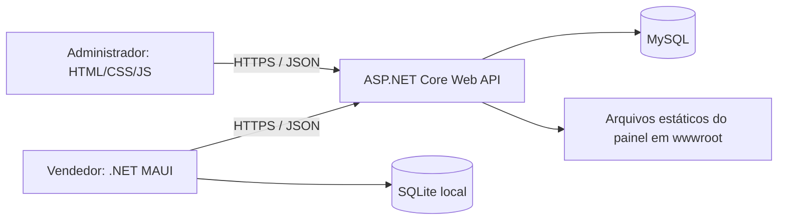

# 02 — Arquitetura e segurança

## Componentes



Uma única API centraliza regras. O painel é servido pela mesma aplicação, usando URLs relativas /api/v1. MySQL não é acessado diretamente pelo navegador nem pelo aplicativo. SQLite não é uma réplica completa do banco central.

## Estrutura proposta

```text
VanderCake/
  AGENTS.md
  README.md
  docs/
  src/
    VanderCake.Api/
      Controllers/
      Contracts/
      Models/
      Data/                 # contexto e migrations
      Services/             # pedidos, corte, financeiro e autenticação
      wwwroot/
        index.html
        pages/
        css/
        js/                 # cliente HTTP, sessão e módulos das telas
    VanderCake.Mobile/
      Views/
      ViewModels/
      Models/
      Services/             # API, sessão e SQLite
  tests/
    VanderCake.Tests/
```

EF Core com provedor MySQL compatível é a proposta para persistência central. A seleção da biblioteca SQLite e das versões fica para a validação de ambiente; não existe versão de framework confirmada pelo usuário. O projeto MAUI usa MVVM simples, com serviços HTTP compartilhados entre telas.

## Autenticação proposta

- Uma base de usuários e hash de senha com componente estabelecido da plataforma; não criar algoritmo próprio.
- Painel: cookie de autenticação HttpOnly, Secure e SameSite, com proteção CSRF nas operações de escrita, inclusive configuração segura do login.
- MAUI: token Bearer com expiração limitada, mantido no armazenamento seguro do dispositivo. Sem refresh token na primeira versão; solicitar novo login ao expirar.
- Configurar esquemas explicitamente: cookie para o painel e Bearer para o aplicativo, com as mesmas políticas de autorização. Não colocar token em URL, SQLite ou localStorage.
- Painel obtém token antifalsificação em /auth/csrf e o envia no cabeçalho X-CSRF-TOKEN para mutações autenticadas por cookie.
- Usuário inativo não pode fazer login nem executar novas operações; autorização consulta a situação vigente.
- Logout limpa a sessão do cliente. No MAUI, o Bearer já emitido pode permanecer válido até expirar; manter validade curta e registrar essa limitação.

## Validação e proteção

- Resolver identidade e perfil no servidor. VendedorId é obtido da sessão para criação de pedidos e clientes do vendedor.
- Validar acesso também nos itens, histórico, parcelas e pedidos, não apenas nas listas.
- Retornar DTOs explícitos; nunca serializar hash de senha ou entidades completas indiscriminadamente.
- Consultas parametrizadas/ORM; conteúdo textual do painel inserido com textContent, sem HTML arbitrário.
- Limites de paginação, tamanho de campos e quantidade de itens por pedido.
- Usar restrições e transações no banco além das validações de interface.
- Desabilitar CORS amplo; o painel é mesma origem. Caso precise de outra origem, configurar uma lista explícita.
- Conexões e chaves ficam em configuração local/variáveis de ambiente; fornecer somente arquivo de exemplo sem valores reais.
- Usuário do banco com privilégios necessários à aplicação. Credenciais de migração podem ser separadas.
- Não registrar tokens, senhas ou payloads completos contendo dados pessoais.
- Desabilitar detalhes de exceção para o cliente; registrar identificador de correlação.

## Comunicação local para apresentação

O destino atual é MAUI Windows, no mesmo computador da API, usando localhost em Debug. Validar conexão e certificado ao trocar de ambiente. Não deixar bypass de validação TLS na versão entregue. Evitar hospedagem externa antes de confirmar exigência do professor.

## SQLite

Salvar rascunhos e cache por usuário. Internet continua obrigatória para autenticação, consultas atualizadas e envio. Na troca de conta, limpar cache e impedir que outro usuário leia rascunhos anteriores. Não gravar saldo devedor sensível permanentemente sem necessidade. SQLite não guarda estoque oficial nem define aprovação.
