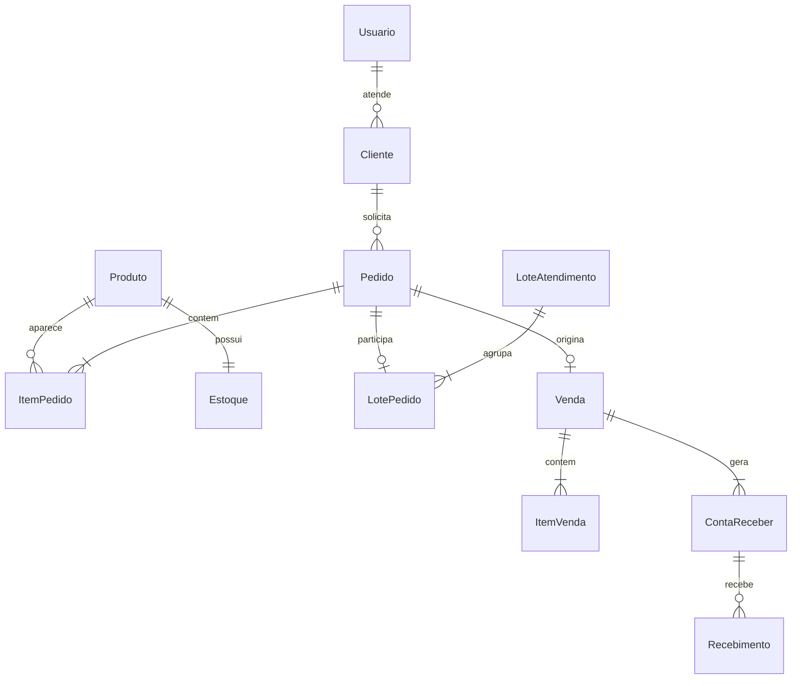

# 04 — Modelo de dados

Modelo lógico para orientar migrations, não script SQL pronto. Campos monetários: DECIMAL(15,2); percentuais: DECIMAL(5,2); quantidades: INT. IDs centrais: BIGINT, serializados como strings no JSON para evitar perda de precisão no JavaScript. SQLite usa UUID para rascunhos.

## MySQL

| Entidade | Campos principais e vínculos |
|---|---|
| Usuario | id, nome, login único normalizado, senhaHash, perfil ADMIN/VENDEDOR, ativo, criadoEmUtc |
| Estado | id, uf única, nome |
| Cidade | id, estadoId FK, nome; unicidade estado/nome |
| Cliente | id, nome, documento opcional único quando preenchido, telefone, logradouro, numero, bairro, cep, cidadeId FK, vendedorId FK Usuario, ordemVisita, ativo |
| GrupoProduto | id, nome único, ativo |
| Produto | id, codigo único, descricao, grupoId FK, unidadeComercial, precoAtual, ativo |
| Estoque | produtoId PK/FK, saldo, versao de concorrência |
| MovimentoEstoque | id, produtoId FK, tipo ENTRADA/AJUSTE/SAIDA_VENDA, quantidadeComSinal, motivo, vendaId FK opcional, usuarioId FK, criadoEmUtc |
| FormaPagamento | id, nome único, ativo |
| CondicaoPagamento | id, nome, multaPercentual, jurosDiarioPercentual, descontoDiarioPercentual, ativo |
| CondicaoParcela | id, condicaoId FK, numero, dias, percentual; unicidade condicao/numero |
| Pedido | id, clienteId FK, vendedorId FK, situacao, enviadoEmUtc, condicaoId FK, formaId FK, condicaoNomeSnapshot, formaNomeSnapshot, multaPercentualSnapshot, jurosDiarioPercentualSnapshot, descontoDiarioPercentualSnapshot, totalSolicitado, totalAprovado, versao, motivoCancelamento opcional, canceladoEmUtc opcional, canceladoPorId FK opcional |
| ItemPedido | id, pedidoId FK, produtoId FK, descricaoSnapshot, unidadeSnapshot, quantidadeSolicitada, quantidadeAprovada nula até atendimento, precoUnitario; unicidade pedido/produto |
| LoteAtendimento | id, administradorId FK, confirmadoEmUtc, chaveIdempotencia única por administrador, previewTokenHash |
| LotePedido | loteId FK, pedidoId FK único; PK composta |
| Venda | id, pedidoId FK único, loteId FK, clienteId FK, vendedorId FK, dataVenda, total, condicaoNomeSnapshot, formaNomeSnapshot, parâmetros informativos snapshot |
| ItemVenda | id, vendaId FK, itemPedidoId FK único, produtoId FK, descricaoSnapshot, unidadeSnapshot, quantidade, precoUnitario, subtotal |
| ContaReceber | id, vendaId FK, numeroParcela, vencimento, percentualSnapshot, formaNomeSnapshot, valorOriginal; unicidade venda/numeroParcela |
| Recebimento | id, contaReceberId FK, valor, dataRecebimento, usuarioId FK, criadoEmUtc, chaveIdempotencia única por usuário |
| RequisicaoIdempotente | id, usuarioId FK, operacao, chave, hashConteudo, recursoId, criadoEmUtc; unicidade usuario/operacao/chave |

O hash do conteúdo e o recurso da confirmação/recebimento podem usar RequisicaoIdempotente, mantendo também os vínculos únicos de domínio. Nenhuma tabela armazena senha em texto puro.

Condição enviada no pedido fica congelada por cópia dos prazos/percentuais e nomes em tabela PedidoParcelaCondicao (pedidoId, numero, dias, percentual) e campos snapshot no pedido. Assim, alteração posterior do cadastro não muda o parcelamento já combinado. Venda copia esses termos, e ContaReceber guarda o resultado final.

Tokens de prévia podem ser assinados ou persistidos temporariamente com hash, payload e expiração. Não aceitar payload não verificável do navegador como prova de disponibilidade de estoque.

## Restrições e índices

- FKs obrigatórias e exclusão restrita para entidades usadas em pedidos/vendas. Preferir inativar cadastros.
- precoAtual > 0; saldo >= 0; quantidades solicitadas > 0; 0 <= aprovada <= solicitada.
- Valores de parcela/recebimento > 0; percentuais > 0 para parcelas.
- Soma de percentuais e saldo de recebimento validados no serviço sob transação; não são resolvidos por CHECK de linha.
- Índices em Cliente(vendedorId, ativo, ordemVisita), Pedido(situacao, enviadoEmUtc), Pedido(vendedorId, enviadoEmUtc), Pedido(clienteId, enviadoEmUtc), ContaReceber(vencimento), Recebimento(contaReceberId), MovimentoEstoque(produtoId, criadoEmUtc).
- FK de vendedor deve apontar para usuário de perfil vendedor; validar no serviço.
- Recebimento concorrente bloqueia/revalida a conta antes de gravar para impedir pagamento acima do saldo.
- Manter registros de idempotência durante toda a demonstração/primeira versão; limpeza futura precisa considerar a janela de repetição de clientes.

## Relacionamentos principais

## SQLite no MAUI

| Tabela | Finalidade |
|---|---|
| RascunhoPedido | uuid, usuarioId, clienteId, condicaoId, formaId, estadoLocal, chaveTentativa, hashTentativa, pedidoServidorId opcional, atualizadoEmUtc |
| RascunhoItem | id local, rascunhoUuid FK, produtoId central, quantidade, precoConsultado |
| CacheCliente | id central, usuarioId, nome, cidade, ordemVisita, atualizadoEmUtc |
| CacheProduto | id central, descricao, grupo, unidade, precoConsultado, ativo, atualizadoEmUtc |
| CacheCondicaoForma | identificação e termos necessários à montagem de pedido, atualizadoEmUtc |

Estados locais: EDITANDO, ENVIO_INCERTO, ENVIADO. Persistir chave e conteúdo antes da chamada HTTP. Após timeout, manter ENVIO_INCERTO até consultar/repetir a tentativa; não apagar o rascunho. Após sucesso, marcar ENVIADO e guardar ID central. Gravações de rascunho/itens em transação local. Sem fila automática de envio ou reconciliação offline.
